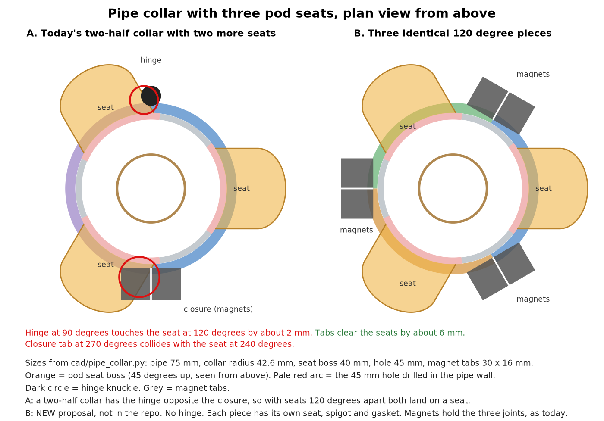

# Pipe collar with three pod seats, three identical pieces (OpenPocket #563)

Script: `cad/pipe_collar_3seat.py` (pictures: `cad/render_pipe_collar_3seat.py`), drawings "Pipe collar draft V2" (supersedes the single-seat draft V1) on the Drawings page. It imports everything from `cad/pipe_collar.py`. The one seat O-ring (green ring) is defined once there, as `seat_oring()` (`seat_orings()` of the single collar builds the same ring); the three-seat script imports it and defines no ring of its own. Published ids are `pipe-collar-3seat-*-v2`.

**Reference** (approved by the owner, option B of Viber sketch SUPhkmDEjmXn; option A, today's two halves with two more seats, was rejected because the hinge and the closure both land on a seat):

**What is built**
- Three seats at 0, 120 and 240 degrees, all at z = 68, each with its own 45 mm hole, spigot, gasket ring, seat O-ring groove and plug holder (as the single-seat collar). About 46.3 degrees of pipe wall stay intact between neighbouring holes.
- Three IDENTICAL pieces, each 120 degrees wide, centred on its seat (-60 to +60). One part, printed three times. No hinge, no pin, no knuckles.
- Joints at 60, 180 and 300 degrees. At each end of a piece the same magnet tab as the real closure: 30 mm wide across the joint, radius 39.6 to 55.6, z 31 to 61, two 10 x 3 mm N52 magnets at z 38 and 54 (pockets 10.2 x 3.2). The -60 degree end is the "front" tab (N out at z 38, S out at z 54), the +60 degree end the mirror, so at every joint the pair faces attract.
- The spigot in each hole stops the collar sliding or turning; the magnets only keep the pieces closed and aligned. The pieces stand 1 mm apart at the joints (the magnets pull them to about 1.2 mm face to face), as in the real collar.

**Checks** (`python cad/pipe_collar_3seat.py`, all printed, all in the build): no overlap between the three pieces, the pipe (with its three holes), the spine, a seated pod, a seated plug and a parked plug (also between those objects); magnets sit fully inside their pockets and touch no plastic; the single collar's pod depth numbers hold for every seat (3.0 mm from the pod to the spine). Plan view: magnet tab to seat boss 6.8 mm (the drawing says about 6), tab to the spigot ring 4.5 mm.

**Compared with the reference drawing**: seats at 0/120/240 and tabs at 60/180/300 as drawn. Differences: the drawing has no spine and no pipe wall drawn except as rings, the render shows the 108 mm tall collar from above so the seat bosses are seen as 45 degree tilted cylinders (the drawing shows them flat); the render tints the three pieces differently so they can be told apart (they are the same part); the drawing's tab gap "about 6 mm" is 6.8 mm measured.

**Open questions for the owner**
1. Plug holders: one per seat (three per collar) is ASSUMED, as in the real collar. Are three too many?
2. How many collars per unit and what pitch between them? The real hole positions are still not in the repo.

**Round 2 (owner review)**: the geometry is kept. (1) The seat O-rings: the first ring was inherited from the single collar, where it sits on a straight axis at the hole height; this collar has no straight seat there, so it floated loose in the bore (seen in the top opening and through the front hole). It now sits in the 45 degree seat's own groove (the second ring stays in the plug holder's groove). Checked: no overlap with the pieces, the pipe or the gasket; each ring only squeezes the pod or plug body of its own seat (about 77 mm3, the intended 24 mm ring on a 25 mm body). (2) The Drawings page: the four three-seat cards (assembled first, then one piece, pods, exploded) now stand where the old single-seat "pipe collar" cards were; those five old cards (pod seated, magnet closure, pod close-up, plug in the hole, plug parked) are retired to the Archive, nothing deleted.
